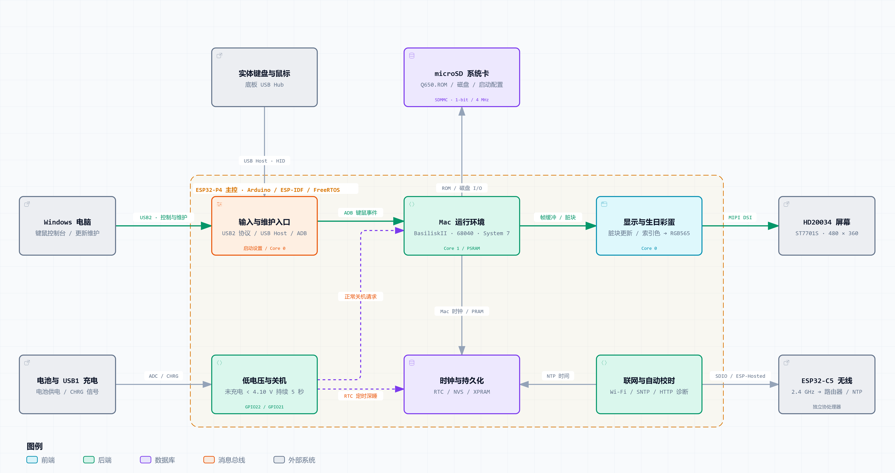
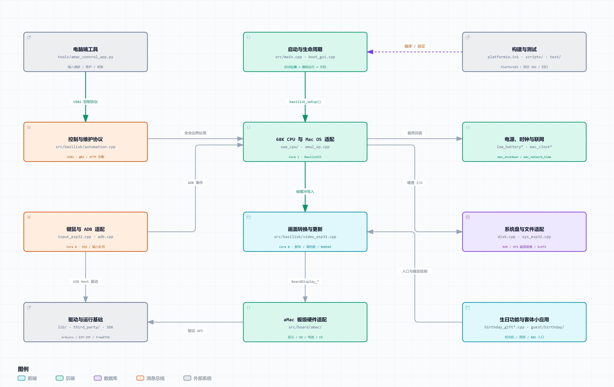

# aMac 系统架构与代码框架

核对日期：2026-11-16。固件版本：`5.4-beta.1+amac.0.6.4`。
源码基线：`a3093fea7bf2a31d75045853512cc8bd2e7fadb0`。
本文依据当前实现绘制；箭头概括主要调用、数据流或控制关系，没有展开全部函数调用。

## 系统架构



[打开可缩放的系统架构图](output/architecture/amac-system.html)
· [SVG 矢量图](output/architecture/amac-system.svg)
· [可编辑图形数据](output/architecture/amac-system.architecture.json)

Mac 的 68040 CPU、内存、系统和应用由 **ESP32-P4 上的 BasiliskII** 模拟。
ESP32-C5 是独立的无线协处理器，通过模组内部的 SDIO 与 P4 通信。
Mac 的 ROM、系统盘、应用、用户文件和启动配置主要放在 microSD 卡上。

主要路径：

- **实体键鼠**：USB Hub → USB Host/HID → 输入适配 → ADB → Mac。
- **电脑键鼠**：Windows 控制台 → USB2 控制协议 → 输入适配 → ADB → Mac。
- **画面**：Mac 帧缓冲 → 脏块快照与调色板转换 → RGB565 → 板级显示驱动 → MIPI DSI 屏幕。
- **联网校时**：C5 接入 Wi-Fi → P4 的 SNTP 服务 → 主任务应用校时结果 → Mac 时钟与 NVS 检查点。
- **低电压**：GPIO22 电压采样、GPIO21 CHRG → 保护策略 → Finder 正常关机 → 磁盘清理 → 深睡。

图中的“前端”“后端”“数据库”“消息总线”是绘图工具的模块分类：
在本项目里分别对应显示交互、固件逻辑、持久数据、输入与控制协议，不表示部署了额外的服务器或数据库服务。

### USB1、USB2 和 USB Host

| 接口 | 当前作用 |
| --- | --- |
| USB1 | 供电/充电，以及经 CH343 和 SW1 选择的 P4/C5 UART 调试 |
| USB2 | P4 内部 USB Serial/JTAG；键鼠转发、诊断、固件更新和 SD 文件维护 |
| 底板 USB Hub/Host | 连接实体 USB 键盘和鼠标，与 USB2 的电脑连接相互独立 |

USB2 的 VBUS 没有连接到板上供电，不能用 USB2 数据线代替电池或 USB1 供电。
SD 文件写入在维护设置中进行；运行 Mac 时不能直接改正在使用的系统盘。

## 代码框架



[打开可缩放的代码框架图](output/architecture/amac-code.html)
· [SVG 矢量图](output/architecture/amac-code.svg)
· [可编辑图形数据](output/architecture/amac-code.architecture.json)

```text
firmware/
├─ platformio.ini                     构建环境、固定 SDK、编译选项
├─ src/
│  ├─ main.cpp                        设备启动、设置入口、模拟器退出与关机
│  ├─ firmware_version.h              aMac 版本标识
│  ├─ basilisk/
│  │  ├─ main_esp32.cpp               模拟器初始化、运行、维护与退出
│  │  ├─ uae_cpu/                    68K CPU、内存访问和执行循环
│  │  ├─ emul_op.cpp                 Mac OS/ROM 与宿主实现之间的桥接
│  │  ├─ rom_patches.cpp             ROM 适配补丁
│  │  ├─ rsrc_patches.cpp            系统资源补丁及安全空闲回调
│  │  ├─ boot_gui.cpp                启动设置、联网配置与维护界面
│  │  ├─ automation.cpp              USB2 协议、截图和 HTTP 诊断
│  │  ├─ sd_maintenance.cpp          SD 文件传输、校验和替换
│  │  ├─ input_esp32.cpp             输入任务、USB Host 和转发输入
│  │  ├─ input_usb_host.inc          USB HID 接收和报告处理
│  │  ├─ adb.cpp                     Mac ADB 键鼠适配
│  │  ├─ video_esp32.cpp             脏块、调色板、画面更新
│  │  ├─ disk.cpp / sys_esp32.cpp    Mac 系统盘与宿主文件适配
│  │  ├─ extfs.cpp                   共享目录适配
│  │  ├─ low_battery_amac.cpp        电压保护、深睡、充电唤醒
│  │  ├─ mac_shutdown.cpp            Finder 正常关机事件
│  │  ├─ mac_clock_esp32.cpp         RTC、Mac 时钟与 NVS 检查点
│  │  ├─ mac_network_time.cpp        网络校时及主任务交接
│  │  ├─ xpram_esp32.cpp             将 XPRAM 保存到 SD
│  │  └─ birthday_gift*.cpp          生日状态机、图形与 P4 运行接入
│  ├─ board/
│  │  ├─ board_*.h                  统一板级接口
│  │  └─ amac/
│  │     ├─ board_amac.cpp          aMac 硬件初始化及接口实现
│  │     ├─ board_display_amac.cpp  HD20034/ST7701S 显示驱动
│  │     ├─ board_sd_amac.cpp       SDMMC 引脚、供电域与挂载
│  │     ├─ board_power_amac.cpp    原始电池电压和 CHRG 采样
│  │     ├─ board_wifi_amac.cpp     C5 复位与无线准备
│  │     └─ amac_pins.h             最新网表对应的引脚定义
│  └─ generated/                    构建时生成的图形资源
├─ tools/
│  ├─ amac_control_app.py             Windows 控制台界面
│  ├─ amac_input_windows.py           本机键盘捕获和鼠标约束
│  ├─ amac_input.py                   按键映射、输入缓冲、单一串口线程
│  ├─ mac_control.py                  电脑端协议客户端
│  ├─ amac_maintain.py                维护工具
│  └─ amac_update.py                  备份、更新与独立校验
├─ guest/birthday/                    安装到 Mac 系统盘的 68K 小应用
├─ lib/                              项目依赖和显示驱动
├─ third_party/                      固定版本的第三方源码
├─ hardware/                         网表、屏幕参考与引脚依据
├─ scripts/                          构建、运行、更新、安装和打包入口
└─ test/                             主机回归与生产代码检查
```

USB Host/HID 的实际实现在共享输入层，未放进 `src/board/amac/`。
生日功能的 `guest/birthday/` 是 Mac 系统盘中的 68K 入口；P4 固件里的
`birthday_gift*.cpp` 实现交互状态和叠加绘制。只更新 P4 固件不会自动给磁盘添加桌面图标。

## 任务和并发分工

| 运行位置 | 主要工作 | 与其他部分的交接 |
| --- | --- | --- |
| Core 1：Arduino 主任务/模拟器 | 启动界面、68K CPU、Mac OS 桥接、主任务控制处理 | 在安全的 CPU 边界处理请求；在客体安全空闲回调请求正常关机 |
| Core 0：InputTask | HID 接收、输入分发、电池与充电采样 | ADB 输入；低电压状态交给客体安全回调 |
| Core 0：VideoTask | 脏块快照、调色板转换、生日画面合成、显示提交 | 读取同步后的帧信息；调用 `BoardDisplay_*` |
| Core 0：Automation | USB2 控制协议与维护请求 | 输入队列、启动控制请求队列、截图同步 |
| Core 0：AutomationNet | HTTP 画面诊断 | 与显示截图访问协调 |
| SDK 网络回调 | 接收 SNTP 时间样本 | 只缓存结果，由 `MacNetworkTimePoll()` 在主任务应用 |

电压保护不依赖 Mac 显示的电量百分比，也不依赖是否启用客体 Power Manager。
这些服务跨任务协作，不是每个文件各自运行一个独立线程。

## 启动与关机

正常启动顺序：

1. `src/main.cpp` 首先做低电压/RTC 唤醒检查。
2. 初始化板级硬件、屏幕和电源接口，显示启动画面。
3. 挂载 SD，初始化启动设置、实体 USB 输入和 USB2 控制。
4. 用户进入设置，或按保存的配置继续启动。
5. `basilisk_setup()` 加载 ROM、内存和系统盘，启动模拟运行与各任务。

低电压关机顺序：

1. 未充电且实测电压严格低于 **4.10 V 持续 5 秒**，设置关机请求。
2. 在 Mac 安全空闲回调发送 Finder 正常关机事件；等待应用处理保存/取消提示。
3. 实际收到 Mac 的 PowerOff 后，停止模拟任务，刷新磁盘、XPRAM 和时钟检查点。
4. 停止 SD、无线和显示，保持相关引脚状态，进入深睡。
5. RTC 每 **5 秒**短暂检查充电信号；没有新充电就直接再次深睡。
6. 检测并确认新充电后重新启动。深睡保留 RTC，不保存应用 RAM 或运行现场。

GPIO21 的 CHRG 不是独立的 VBUS 插线检测；满电时插线若 CHRG 没有变化，
不能保证充电唤醒。完整行为与硬件限制见 [关机与充电唤醒](AMAC_POWER_OFF.md)。

## 数据放在哪里

| 位置 | 内容 |
| --- | --- |
| microSD | `Q650.ROM`、Mac 磁盘映像、启动配置、共享目录、`BasiliskII_XPRAM` |
| P4 Flash | 固件、分区和 NVS；NVS 保存 Mac 时钟检查点 |
| P4 PSRAM/运行内存 | 客体 RAM、运行中的模拟状态、画面和处理缓冲 |
| RTC 保持区 | 深睡跨周期的时钟与充电等待状态；完全断电后不保证保留 |

## 维护定位

| 想修改的部分 | 优先阅读 |
| --- | --- |
| 启动流程或启动设置 | [main.cpp](src/main.cpp)、[boot_gui.cpp](src/basilisk/boot_gui.cpp) |
| 实体鼠标、键盘或电脑输入的设备端处理 | [input_esp32.cpp](src/basilisk/input_esp32.cpp)、[input_usb_host.inc](src/basilisk/input_usb_host.inc) |
| Windows 控制台 | [amac_control_app.py](tools/amac_control_app.py)、[amac_input.py](tools/amac_input.py) |
| 画面更新、颜色或生日绘制 | [video_esp32.cpp](src/basilisk/video_esp32.cpp)、[birthday_gift_amac.cpp](src/basilisk/birthday_gift_amac.cpp) |
| 屏幕时序、硬件引脚、SD 或 C5 | [板级目录](src/board/amac/)、[硬件依据](hardware/README.md) |
| 电压、关机、深睡或唤醒 | [low_battery_amac.cpp](src/basilisk/low_battery_amac.cpp)、[mac_shutdown.cpp](src/basilisk/mac_shutdown.cpp) |
| 自动校时与 RTC | [mac_network_time.cpp](src/basilisk/mac_network_time.cpp)、[mac_clock_esp32.cpp](src/basilisk/mac_clock_esp32.cpp) |
| 更新和 SD 文件维护 | [amac_update.py](tools/amac_update.py)、[sd_maintenance.cpp](src/basilisk/sd_maintenance.cpp) |

## 图形的验证与来源

两张交互图分别核对了 21、30 条源码/项目资料引用，均通过 9 项图形检查，
没有检测到布局错误或警告。浏览器检查覆盖 1440×900、1600×1000、
1920×1080 和 2048×1320；已查看浅色、深色截图和原生导出的 PNG。
本次只新增文档与图形，没有更改运行代码、重新烧录或重新测量设备。

图形数据、交付摘要、浏览器记录和导出摘要位于 [output/architecture/](output/architecture/)。
后续代码改变后应重新核对图形，而不能仅修改版本文字。
