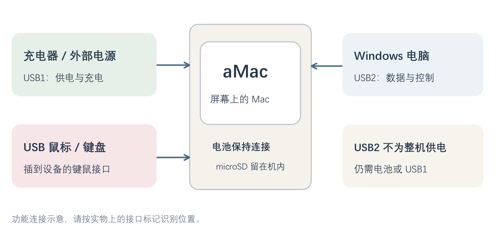
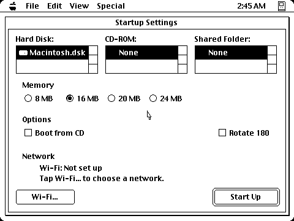
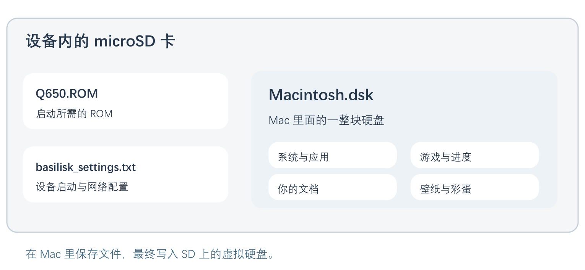
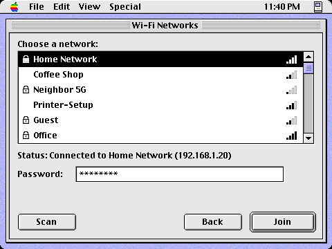
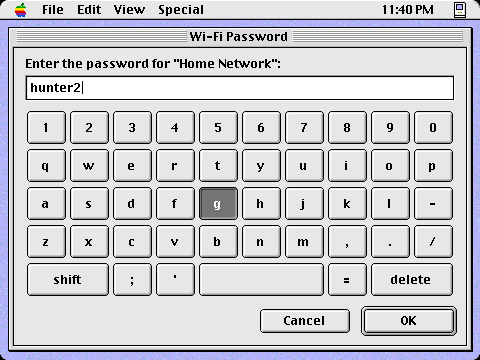
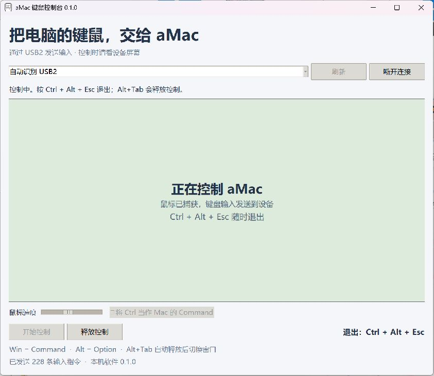
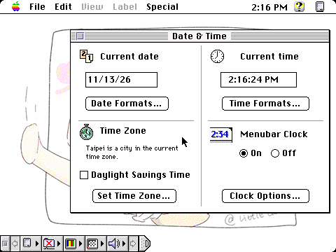
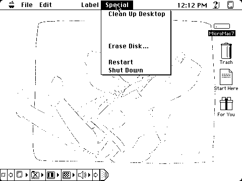
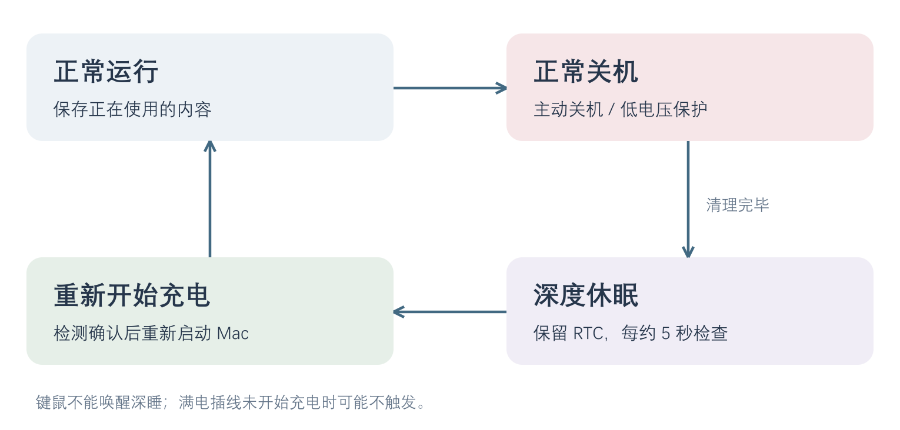
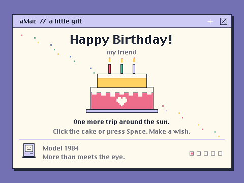

# aMac 新手使用指南

从第一次开机，到日常使用、电脑键鼠控制与不拆机维护。

**适用版本：设备固件 0.6.3 / Windows 键鼠控制台 0.1.0。**
适用硬件：本项目的 ESP32-P4/C5 小电脑、HD20034 480×360 屏幕。
编写日期：2026 年 11 月 13 日。

本指南以已经装好系统的生日版实机为例。界面中英文名称保留，旁边附中文说明。
实际时间、网络名、系统盘名称和内存选择可能与插图不同。Wi-Fi 插图使用演示数据。

[下载图文 PDF](output/pdf/aMac_User_Guide.pdf) · [项目首页](README.md)

## 01 / 先用起来：第一次的 8 个步骤

1. **接好供电。** 电池保持接好，把充电线接到设备的 **USB1**。第一次使用建议先接着电源操作。
2. **接上鼠标。** 将 USB 鼠标或鼠标接收器接到设备上用于键鼠的 USB 接口。屏幕没有触摸功能，点击屏幕不会操作系统。
3. **等待启动。** 已配置好的设备通常直接进入 Mac。期间可能先显示启动画面，随后才出现桌面，不必连续按 RESET。
4. **如果出现 Startup Settings，** 确认 Hard Disk 中选中了系统盘，再点右下角 **Start Up**。不确定的选项先保留原值。
5. **认识桌面。** 双击 **Start Here** 阅读机内说明；双击 **For You** 打开这份礼物的第一个入口。
6. **保存自己的内容。** 在应用里点 **File → Save**。弹出保存对话框时，选择 Mac 硬盘并起一个英文文件名。
7. **离开前正常关机。** 先保存并退出应用，在桌面上选择 **Special → Shut Down**。
8. **再次开机。** 关机进入深睡后，重新接入 USB1 充电可触发开机。若关机时已经插着电，先拔 USB1，等待至少约 6 秒再插回。满电时可能不触发，处理方法见第 10 节。

> 最先记住三件事：USB1 用于供电/充电，USB2 用于电脑数据连接；关机要用 Shut Down；深睡后键鼠不能唤醒。

## 02 / 认识接口和按键

图 1：连接关系示意。图中的位置不代表实物布局，请认设备上的 USB1、USB2 标记。

| 标记 | 作用 | 日常怎样用 |
| --- | --- | --- |
| USB1 | 外部供电、充电，同时有调试串口 | 接充电器或供电线；充电唤醒也看这一路 |
| USB2 | P4 与电脑之间的数据、控制和维护 | 用数据线连接 Windows 控制台、维护工具或更新工具 |
| USB 键鼠口 | 连接鼠标、键盘或接收器 | 接到设备本身；不要和连接电脑的 USB2 混淆 |
| microSD | 存放启动资料、Mac 系统盘及配置 | 正常使用时一直留在设备里，通常无需拔卡 |
| RESET / SW2 | 重新启动主控 | 已关机但插电不能唤醒时可用；运行中不要当作正常关机键 |
| BOOT / SW3 | 进入烧录模式时使用的按键 | 正常使用不用按，不是开机菜单键 |
| SW1，P4 / C5 | 调试对象选择开关 | 通常保留交付状态；它不是电源开关，也不是 Wi-Fi 开关 |

**USB2 不能代替 USB1 给整机供电。** 本板 USB2 的电源脚未接入供电路径。只插 USB2 时，仍需要电池或 USB1 供电。

电脑连接线必须支持数据。有些线只能充电：插上后电脑没有新串口，换一条已知能传文件的数据线再试。

不需要同时连接两种鼠标。可以直接用设备上的 USB 鼠标，也可以使用第 8 节的电脑键鼠控制台。维护时则先断开控制台，让维护工具使用 USB2。

## 03 / 开机时看到了什么

图 2：Startup Settings 启动设置的实机示例。图中时间和 16 MB 选择仅是拍摄时的状态，不要求照抄。

正常启动会经历设备初始化、读取 SD、加载 Mac 系统、进入桌面。**控制接口显示“正在运行”不等于桌面已经加载完毕**，请以屏幕上的实际画面为准。

| 英文选项 | 中文意思 | 给新手的建议 |
| --- | --- | --- |
| Hard Disk | Mac 虚拟硬盘 | 选已有系统盘，当前常见文件名为 Macintosh.dsk |
| CD-ROM | 光盘映像 | 日常使用通常为 None；安装软件时才另行配置 |
| Shared Folder | 共享文件夹 | 保留已有配置；它不等于电脑的任意文件夹会自动同步 |
| Memory | 分配给 Mac 的内存 | 保留交付配置；不是电脑本身的存储容量 |
| Boot from CD | 从光盘启动 | 普通启动不勾选 |
| Rotate 180 | 屏幕旋转 180 度 | 只有画面上下颠倒时才调整 |
| Wi-Fi… | 无线设置 | 连接网络、保存密码，操作见第 7 节 |
| Start Up | 保存选择并启动 Mac | 确认选项后点击 |

启动设置页可用**设备上的鼠标**操作。Wi-Fi 密码可用鼠标点屏幕键盘输入。电脑键鼠控制台当前用于 Mac 已启动后的阶段。

若一直停在设置页，先查看有没有错误提示、Hard Disk 是否选中系统盘。看到“保存失败”时先保留现场，检查供电与 SD；不要通过格式化卡来尝试解决。

## 04 / 认识 Mac 桌面

图 3：实机桌面。顶部是菜单栏；右侧依次可见系统硬盘、Trash、Start Here 和 For You。

**顶部菜单属于当前正在使用的应用。** 点击别的窗口，菜单内容可能跟着变化。要找到桌面的 Special 菜单，可以先点一下桌面空白处。

| 画面上的东西 | 它是什么 | 怎样操作 |
| --- | --- | --- |
| 左上角苹果菜单 | 小工具、控制面板和彩蛋入口 | 点击并在菜单里选择项目 |
| File / Edit | 文件、编辑菜单 | 打开、保存、退出、复制和粘贴常在这里 |
| 右上角时间 | Mac 当前时间 | 联网后自动校准为台北时间 |
| MicroMac7 等硬盘图标 | Mac 里面的硬盘 | 双击打开，名称可能被修改过 |
| Trash | 废纸篓 | 接收删除的文件；不熟悉时不要随意清空 |
| Start Here | 机内使用与探索说明 | 双击阅读，建议第一次先打开它 |
| For You | 生日礼物入口 | 双击打开，跟着画面上的线索探索 |
| 底部小条 | Control Strip 控制条 | 某些系统功能的快捷入口，初次使用可先不动 |

Mac 桌面上显示的硬盘和电脑 Windows 的磁盘是两回事。这里保存的文档最终进入 SD 卡上的虚拟硬盘文件，不会自动出现在电脑桌面。

窗口左上角的小方框通常用于关闭窗口。**关掉窗口不一定等于退出应用**，要退出应用请用它的 File → Quit。

## 05 / 鼠标与键盘的基本操作

| 操作 | 做法 |
| --- | --- |
| 选择一个图标 | 左键单击一次 |
| 打开文件、文件夹或应用 | 指针停在图标上，较快地双击左键 |
| 拖动 | 按住左键移动，到目标位置后松开 |
| 移动窗口 | 拖动窗口顶部的标题栏 |
| 使用菜单 | 左键点菜单名称，再选择其中的项目 |
| 取消当前操作 | 先尝试 Esc；对话框优先点击 Cancel |
| 滚动 | 先用窗口上的滚动条；滚轮效果取决于具体 Mac 应用 |

经典 Mac 和 Windows 的常用修饰键不同。**直接插在设备上的 Windows 键盘，其 Windows 键对应 Mac 的 Command，Alt 对应 Option。** Ctrl 保持为 Mac 的 Control。

| 在 Mac 中想做什么 | 设备直连 Windows 键盘上的常用组合 |
| --- | --- |
| 保存 | Windows 键 + S，或直接点 File → Save |
| 复制 | Windows 键 + C |
| 粘贴 | Windows 键 + V |
| 全选 | Windows 键 + A |
| 退出当前应用 | Windows 键 + Q，或点 File → Quit |

快捷键是否有效取决于应用本身。刚开始可以优先用菜单，避免把 Windows 的 Ctrl+S 习惯直接带过来。

右键会按项目的约定转换为 Control+左键；经典 System 7 的软件不一定有现代电脑那样的右键菜单。没有弹出菜单不一定是鼠标故障。

优先使用英文输入和英文文件名。电脑上启用了中文输入法，不代表这台经典 Mac 已经安装中文输入法；键鼠控制台也按物理按键传输。

## 06 / 保存文件：先分清两层硬盘

图 4：外层是 SD 卡上的文件，内层是 Mac 系统盘里的应用、文档和设置。

### 在 Mac 里面保存一份文档

1. 打开能编辑文档的应用，例如阅读 Start Here 时使用的 SimpleText。
2. 如果想写自己的内容，选择应用的 **File → New**，不要直接改掉 Start Here 原说明。
3. 输入内容后选择 **File → Save**。
4. 选择 Mac 系统硬盘中的目标位置，输入英文文件名，例如 `MyNote`。
5. 点击 Save。关闭文档时如果又询问是否保存，确认保存自己的修改。

应用或游戏的进度请使用它自身的 Save 功能。关机前先确认进度已经保存；深睡唤醒会重新启动系统，正在运行的应用不会原样恢复。

### 这三个文件最重要

| SD 卡文件 | 作用 | 能否随便删除或替换 |
| --- | --- | --- |
| Q650.ROM | 模拟器启动所需的 Mac ROM | 不能随便删除；缺少它无法正常启动 |
| Macintosh.dsk | Mac 虚拟硬盘，包含系统、应用、文档、壁纸和彩蛋入口 | 替换它会换掉里面的整套内容；先做备份 |
| basilisk_settings.txt | 启动盘、内存、旋转和 Wi-Fi 等设备配置 | 不熟悉时在设置界面修改，不直接编辑 |

**更新设备固件和替换 Mac 系统盘是两种操作。** 日常固件更新通常不会改变 Mac 里的文档；换一份 Macintosh.dsk 则会换掉该盘内的文档和设置。

将电脑里的文件复制到 SD 根目录，也不意味着文件已经进入 Mac 硬盘。需要向 Mac 系统内安装软件或换壁纸时，按对应安装流程处理，或请维护者帮忙。

## 07 / 连接 Wi-Fi

先连接一次，成功后设备会记住网络，后续启动自动连接。当前实测通过的是 **2.4 GHz、WPA2 网络**，初次设置优先使用这种网络。

### 先进入设备的启动设置

如果设备已经停在 Startup Settings，直接点 Wi-Fi… 即可。如果已经进入 Mac 桌面，需要借助电脑维护工具：

1. USB1 保持供电/充电，用数据线将 USB2 连到电脑。
2. 若电脑键鼠控制台正在连接，先退出捕获，再点 **断开连接**。
3. 打开 `scripts/maintain_amac.cmd`，输入 **4**。第一次会为下一次关机准备维护，并给出提示。
4. 在 **10 分钟内**回到 Mac，保存文件，使用 **Special → Shut Down** 正常关机。
5. 回到维护工具，再输入 **4**，等待设备进入启动设置。此次关机保留了维护连接。

不要先关机很久，再找维护工具。普通关机清理完成后只留约 10 秒窗口，之后会进入深睡；提前准备维护能避免错过。

### 选择网络并输入密码

图 5：Wi-Fi 界面演示。Home Network 等名称和地址都是示例，不代表你的网络。图中出现 5G 名称也不等于本机已验证 5 GHz。

1. 在 Startup Settings 点左下角 **Wi-Fi…**，等待扫描。
2. 在列表中选择自己的网络。列表较长时，点击右侧滚动箭头。
3. 点击 **Password** 密码框，打开屏幕键盘。
4. 用鼠标输入密码，大小写要一致；用 Shift 切换大小写/符号，用 delete 删除输错的字符。
5. 输入完成点 **OK**，回到网络列表，再点 **Join**。
6. 等待状态变为 **Connected** 并出现地址。连接成功后，设备自动保存本次可用的网络和密码，并开启自动连接。
7. 点 **Back** 回到启动设置，再点 **Start Up** 启动 Mac。

图 6：屏幕键盘演示。图中的密码是演示内容，请输入你自己网络的密码。输入框可能直接显示字符，输完后记得点 OK。

扫描最长可能等待约 60 秒，连接最长约 20 秒。失败后可点 Scan 重试，不必连续快速点击 Join。隐藏网络名不会出现在当前扫描列表中。

连接上 Wi-Fi 不代表经典 Mac 浏览器能访问所有现代网页。当前已经实测的是设备联网、自动校时和维护通信；网页兼容性取决于 Mac 内的浏览器。

## 08 / 用电脑的键鼠控制设备

图 7：Windows 键鼠控制台，绿色区域表示正在捕获输入。实际使用已验证可控制设备并正常退出。

如果不想再接一套键鼠，可以使用 **aMac-Control.exe**。这是 Windows 桌面程序，独立 EXE 已包含运行依赖，使用者不用另外安装 Python。

### 第一次连接

1. 保持设备供电，把 USB2 用数据线连接到 Windows 电脑。
2. 关闭占用设备串口的维护工具、更新工具或串口监视器。
3. 双击 **aMac-Control.exe**。本机还可使用 `scripts/run_amac_control.cmd`。
4. 保留 **自动识别 USB2**，点击 **连接设备**。手动选择时以当前电脑识别到的端口为准，本机通常为 COM12。
5. 等设备屏幕出现 Mac 桌面，再点 **开始控制**。
6. 电脑指针被捕获后，观察设备屏幕进行操作。鼠标移动、按键和点击会发送到 Mac。
7. 完成后按 **Ctrl + Alt + Esc**，把键鼠交还给电脑；再按“断开连接”可让其他维护工具使用串口。

### 怎样退出和调整

| 想做什么 | 操作 |
| --- | --- |
| 立即退出捕获 | Ctrl + Alt + Esc |
| 切换到其他 Windows 窗口 | Alt + Tab，会先释放控制 |
| 修改鼠标速度 | 先退出捕获，再调“鼠标速度”滑块 |
| 让 Ctrl+S 像电脑上那样保存 | 退出捕获后勾选“将 Ctrl 当作 Mac 的 Command” |
| 转去更新固件或维护文件 | 退出捕获，然后点击“断开连接” |

默认 Win=Command、Alt=Option、Ctrl=Control。若勾选 Ctrl 转 Command，电脑键盘的 Ctrl+C、Ctrl+V、Ctrl+S 可作为相应 Mac 快捷键使用。退出捕获快捷键仍然是 Ctrl+Alt+Esc。

只有明确开始控制且控制台在前台时才转发输入。窗口失去焦点、移动/缩放、连接中断时会释放控制；按键内容不保存到文件。

滚轮在当前版本中转换为上下方向键，是否滚动取决于应用。电脑剪贴板、文件和中文输入法不会因为键鼠连接而自动同步。

**当前控制台用于 Mac 运行阶段。** Startup Settings 的操作继续使用设备上的鼠标或维护工具。控制台的画面是状态提示，操作时看设备 LCD。

## 09 / 时间会自动更新

图 8：Apple → Control Panels → Date & Time。示例中日期为 11/13/26，时间使用 AM/PM 显示。

固件 0.6.3 会在连接已保存的 Wi-Fi 后，自动从网络获取时间，并按**台北时区 UTC+8**显示。正常每 3 小时再次校时，断线重新连接也会重新请求。

联网和校时在后台进行，Mac 不需要停在某个特别的页面。第一次刚启动时，可能先显示保存的旧时间，收到网络时间后才跳到当前时间。

### 怎样确认已经校时

最直观的是查看桌面右上角时间。要进一步确认，在电脑维护工具里输入 **9 时间同步状态**，可以看到当前日期、时间，以及“等待联网”“正在获取网络时间”或“已校时”。查看状态不要求关闭 Mac，但要先断开键鼠控制台的串口连接。

12 小时制中，**AM 是上午，PM 是下午**，例如 2:26 PM 表示 14:26。日期 11/13/26 表示 2026 年 11 月 13 日。

离线期间使用已有 RTC 时钟继续计时。正常深睡也保留 RTC。完全断电或按 RESET 冷启动时，可能先恢复最近保存的检查点，联网后再校准。

可以在 Date & Time 控制面板手动调整，但联网后的自动校时会再次按台北时间校准。自动获取一直未完成时，先查 Wi-Fi 与网络，再看第 16 节的处理方法。

## 10 / 正常关机、深睡和再次开机

图 9：先回到桌面，再选 Special → Shut Down。菜单里的 Erase Disk… 是擦除磁盘，不是关机。

### 每次离开时这样做

1. 在应用或游戏里保存内容。
2. 如果应用要求保存，处理完保存对话框；需要继续使用时可选 Cancel 取消关机。
3. 退出应用，点桌面空白处，打开 **Special** 菜单。
4. 选择 **Shut Down**，等待系统退出和屏幕关闭。

普通主动关机在清理后保留约 10 秒维护窗口，随后进入深睡。不是按下 Shut Down 就立刻切断电源。

图 10：深睡保留 RTC；再次开机需要新的充电信号，设备每约 5 秒检查一次。

### 当前电压策略

| 条件 | 当前行为 |
| --- | --- |
| 未在充电，电池电压严格低于 4.10 V 持续 5 秒 | 请求 Mac 正常关机，清理后直接进入深睡 |
| 正在充电 | 暂停这项自动低电压关机 |
| 主动选择 Shut Down | 正常关机后进入深睡 |
| 深睡时重新检测到开始充电 | 重新启动 Mac |

4.10 V 是本版设定的保守门槛，不能理解为“已经完全没电”。旧版本的 3.9 V 熄屏、3.7 V 深睡规则已经取消，以本表为准。

**深睡不是保存全部运行内存的电脑休眠。** 它保留 RTC 和少量设备状态，唤醒后重新启动 Mac。游戏和文档靠之前的保存恢复。

### 深睡后怎样开机

如果 USB1 没接着，接入 USB1 使电池开始充电，通常经过一次约 5 秒检查，再进入正常启动流程。

如果关机时 USB1 已经接着，先拔下 USB1，等待至少约 6 秒，再接回，让设备有机会先检测到停止充电。拔插太快可能漏检。

**满电插线不一定能开机。** 当前硬件检测的是“开始充电”信号，没有独立的插线检测。若电池很满、插回后没有重新开始充电，可以在确认 Mac 已关机后按 RESET/SW2 重新启动。

深睡时移动鼠标或按键不能唤醒。只有屏幕保护画面时，可以先尝试移动鼠标或按 Shift；请把屏保与深睡区分开。

## 11 / 查看电池和充电状态

双击电脑上的 `scripts/maintain_amac.cmd`，输入 **8 电池与充电状态**。Mac 正常运行和维护设置中都可查看，不需要先关机。

| 显示 | 怎样理解 |
| --- | --- |
| 电池电压，例如 4.200 V | 设备采样读数，可作为状态参考，尚未用万用表校准绝对精度 |
| 正在充电 | 充电芯片当前报告正在给电池充电 |
| 未在充电 | 可能没插 USB1，也可能已结束充电，不能单凭这句话判断满电 |
| 等待充电状态稳定 | 刚切换供电，等待几秒再查看 |
| 采样无效或已过期 | 当前读数不能作为依据，重新查看并检查供电 |

Mac 里的电池百分比服务目前默认关闭，所以没有百分比或相关值为 0，并不代表电池真的没有电。低电压保护仍独立使用实际采样。

电压不是精确的剩余电量百分比，接上充电线后的电压上升也不等于已经充满。当前没有实测整机深睡电流或完整续航，不能把 3000 mAh 容量直接换算为确定的天数。

若频繁在拔下 USB1 后自动关机，先接回充电，再请维护者查看电压和阈值。不要通过反复复位来持续绕过关机保护。

## 12 / 从 For You 开始探索

图 11：For You 的蛋糕页面。这只是探索的开始，画面里的小提示值得留意。

桌面上有两个适合第一次打开的文件：**Start Here** 给你阅读说明，**For You** 带你进入生日礼物。

1. 双击 For You，读一读屏幕上的英文提示。
2. 尝试点击蛋糕，或者按空格许愿。
3. 画面会给出下一站的线索。可以去苹果菜单里找一找控制面板、Pocket Terminal 和 About This Gift。
4. 如果终端不知道怎么用，先输入 `help` 再回车。
5. 要返回 Mac，使用页面上的关闭按钮，或在相应页面按 Esc。

系统里大约有五处可发现的小惊喜。有的很明显，有的藏得更深。本指南不列完整触发答案，请跟着界面线索慢慢找。

礼物页面里的按键不会同时传给后台 Mac 应用。部分子页面用 Back、Enter 或 Esc 返回上一级，右上角关闭按钮可以回到桌面。

探索进度在当前这次运行中保留；重启后可以重新探索。若桌面没有 For You，通常是换用了另一份没有安装生日入口的系统盘，单独更新固件不会自动创建这些图标。

## 13 / 壁纸和简单个性化

当前生日版已经安装了壁纸工具 **Décor**，正常启动时会加载已保存的壁纸。短时间显示普通灰底时，可以等桌面完成加载后再看。

### 换一张已经放进 Mac 硬盘的图片

1. 双击 Mac 硬盘，找到 **Décor ƒ** 文件夹，再打开 **Décor**。
2. 点 **Change…** 选择 Mac 硬盘里的图片。
3. 将开关设为 **On**，确认桌面效果后退出 Décor 窗口。
4. 保留已安装的 Décor Daemon 扩展，后续启动会加载设置。

本机壁纸位于 `MicroMac7:Wallpaper.gif`，其中冒号表示 Mac 内部路径，不是 Windows 路径。当前屏幕为 480×360，原图也按这个尺寸准备。

如果图片还在 Windows 电脑上，请先请维护者转换、传入 Mac 系统盘，或按项目的壁纸维护说明处理。仅把 PNG 复制到 SD 根目录不会自动变成桌面壁纸。

生日祝福的名字和信件正文目前需要由维护者修改固件中的配置并重新构建，不是直接在“Birthday Settings”里输入姓名保存。

设备没有触摸和音频硬件接口，本版也没有软件亮度渐变：亮度数值变化不等于屏幕一定变暗。这些现象不是你操作错了。

## 14 / 电脑维护工具：菜单怎么选

**普通日常使用不需要电脑维护工具。** 连接网络、备份系统盘、替换卡内文件或更新固件时才用到它。

在本机项目目录 `E:\AMac\firmware` 中双击 `scripts\maintain_amac.cmd`，输入菜单数字后按回车。其他电脑的目录可以不同。

| 数字 | 菜单用途 | 是否需要先关闭 Mac |
| --- | --- | --- |
| 1 | 查看卡内文件 | 需要进入维护设置 |
| 2 | 复制文件到设备 | 需要进入维护设置 |
| 3 | 备份文件到电脑 | 需要进入维护设置 |
| 4 | 准备维护 / 进入维护设置 | Mac 运行时先准备，再正常关机，再选一次 |
| 5 | 启动 Mac | 维护结束后使用 |
| 6 | 查看实体 USB 鼠标状态 | 不需要；电脑控制台的输入不计为实体 USB 鼠标 |
| 7 | 更新设备固件 | 工具会检查运行状态；先按提示正常关机 |
| 8 | 查看电池与充电状态 | 不需要 |
| 9 | 查看时间同步状态 | 不需要 |
| 0 | 退出电脑维护工具 | 不会因此自动关闭 Mac |

同一个串口同一时间只能由一个工具使用。键鼠控制台退出捕获后仍然保持连接，维护前还要点击它的“断开连接”。

### 新电脑要注意

维护 `.cmd` 脚本依赖已经准备好的 Python 和项目环境。**只从 GitHub 下载源码 ZIP，并不等于得到可双击使用的完整维护包**，里面没有本地 `.pio-core` 环境和发布固件。

新手可以向维护者取得已准备好的维护目录。开发环境准备细节见项目的更新说明。独立的 **aMac-Control.exe** 则已经包含自身的运行依赖，不需要这套维护环境。

## 15 / 备份、换文件与更新固件

### 先学会备份系统盘

1. 用 USB2 数据线连接电脑，USB1 保持供电，先断开键鼠控制台。
2. 打开维护工具，选 **4**，为下一次关机准备维护。
3. 在 10 分钟内回到 Mac 保存内容并正常 Shut Down，然后在工具里再次选 **4**。
4. 选 **1** 查看 SD 卡文件，确认系统盘文件名。
5. 选 **3**，输入卡内文件名，例如 `Macintosh.dsk`。
6. 输入电脑上的完整保存路径，例如 `E:\AMacBackup\Macintosh-2026-11-13.dsk`。提前创建目标文件夹，并确认有足够空间。
7. 等工具提示完成后，保留这份备份，再选 **5** 启动 Mac。

完整系统盘约 1 GB 时，传输可能很久。保持线缆、供电和程序稳定，不能只因为进度暂时缓慢就判断失败。日常固件更新不需要重传整份系统盘。

### 复制一个外层文件到 SD

在维护设置中选 **2**，输入电脑源文件完整路径，再输入卡内文件名。当前功能用于 SD 根目录中的普通文件，使用 80 个字符以内的英文/数字文件名，不支持整目录递归复制。

工具先写临时文件并校验，成功后才替换目标，原文件保留为 `.previous`。同一目标下一次成功更新会轮换这份备份，因此重要资料还应另存到电脑。

替换 Macintosh.dsk 会替换盘里的整套内容。Mac 还在运行时不要修改该文件，也不要同时用电脑模拟器打开同一份磁盘来写入。

### 日常更新固件

1. 向维护者取得适合本机的发布镜像及配套 JSON 校验文件。本实机为 P4 v3.2，使用 **Rev3** 版本；不要把 ES、Tab5 或 Waveshare 镜像当作本机版本。
2. USB1 保持供电，USB2 接电脑，关闭其他占用串口的程序。
3. 若 Mac 正在运行，先打开 `scripts/update_amac.cmd`。工具会准备维护并提示正常关机，此次不直接写入。
4. 在 10 分钟内保存并正常 Shut Down，然后重新打开更新工具。
5. 等待自动检查、备份、写入和独立校验。成功后设备会重新启动。
6. 进入桌面后，检查自己的文档、壁纸和彩蛋入口，再查看联网与时间。

日常更新保留 SD 卡、Mac 系统盘和设备配置。无线芯片 C5 有独立固件，不需要每次跟着重刷。工具若报告未知引导版本、镜像不匹配或备份校验失败，先停止并保留提示交给维护者。

BOOT、烧录开关、全片擦除、手动指定地址等操作不属于新手日常更新流程，不要把网上其他开发板的烧录步骤直接套用到这台机器。

## 16 / 出问题时，按这个顺序检查

### 黑屏，插线后也没有开机

1. 确认接的是 **USB1**，不是只插了 USB2；电池连接也要正常。
2. 如果刚关机且一直插电，拔 USB1 等至少约 6 秒再接回，之后留出检查和系统启动时间。
3. 如果电池很满，可能没有新的充电信号；确认 Mac 已经关机后，可按 RESET/SW2 启动。
4. 若看到的是屏保，先移动鼠标或按 Shift。若仍无反应，再区分深睡与供电问题。

### 鼠标不动、偶尔不识别或乱跳

先看是不是整台机器还在启动。设备上的 USB 鼠标可拔下，等约 3 秒再插回，然后移动测试。不要同时拔掉供电。

用维护菜单 **6** 查看“已连接/未检测到”和输入报告数。未检测到时优先查接收器、线缆和接口；已连接但移动不增加报告时，再用手边另一只鼠标交叉验证。正常厂商状态包不一定计为有效位移。

使用电脑控制台时，确认已经“开始控制”、窗口还在前台。需要释放时按 Ctrl+Alt+Esc；调低鼠标速度后重试。电脑控制台的输入和实体 USB 鼠标统计是两条路径，不能只用菜单 6 判断控制台是否工作。

### 电脑控制台连不上

检查 USB2 是否为数据线，设备是否有供电，以及维护工具/串口监视器是否仍占用端口。退出捕获不等于断开串口。必要时刷新端口列表并手动选择当前端口，COM12/COM7 只是本机曾使用的号码。

设备深睡时维护连接可能消失，先充电唤醒；不要为了找串口反复按 BOOT 或切换 P4/C5。

### Wi-Fi 扫描不到网络

先把设备放到已有 2.4 GHz、WPA2、能广播名称的网络附近，再点 Scan 等待。注意区分“模块启动失败”“扫描失败”和“列表为空”。它们不代表同一种故障。

初始化失败或反复扫描失败时，记录完整提示，请维护者检查 C5。不要自行把其他型号的无线固件刷到 C5。

### Wi-Fi 已连上，但时间不对

确认这个网络能访问外网，等一会儿，再用菜单 **9** 查看是否“已校时”。只有网络名称显示 Connected，不代表已经收到网络时间。离线冷启动显示旧检查点是可能的，重新联网后会校准。

### 保存失败、找不到系统盘、反复回到启动设置

保留报错内容，确认供电稳定、Hard Disk 选中了正确系统盘。不要随意格式化 SD，也不要删除 ROM、系统盘或恢复标记来碰运气。先做可行的备份，再由维护者排查卡和配置。

### 没声音、点屏幕无反应、亮度变化不明显

本机没有启用触摸和音频硬件；背光为开/关控制，软件百分比不是连续亮度调节。这些情况先按功能边界理解，不必因此重装 Mac。

### 程序卡住了

先等待并尝试退出当前应用，处理可能挡住的对话框。如果鼠标还能用，尽量先保存和正常关机。RESET 会中断运行并丢失未保存内容，作为最后的恢复手段；重启后如果进入维护设置，不要直接清空系统盘。

## 17 / 快速查阅与小词典

| 我现在想做什么 | 最快的入口 |
| --- | --- |
| 看机内说明 | 桌面 Start Here |
| 打开生日礼物 | 桌面 For You |
| 正常关机 | 桌面 Special → Shut Down |
| 用电脑键鼠操作 | aMac-Control.exe → 连接设备 → 开始控制 |
| 把键鼠交还电脑 | Ctrl + Alt + Esc |
| 设置 Wi-Fi | 进入维护设置 → Wi-Fi… |
| 看电压/是否在充电 | 电脑维护菜单 8 |
| 看网络校时是否成功 | 电脑维护菜单 9 |
| 备份系统盘 | 正常关机进入维护 → 菜单 3 |
| 更新设备固件 | scripts/update_amac.cmd |

| 英文 | 中文 |
| --- | --- |
| File / Edit | 文件 / 编辑 |
| Save / Save As… | 保存 / 另存为 |
| Quit / Close | 退出应用 / 关闭窗口 |
| Cancel / OK | 取消 / 确定 |
| Special / Shut Down / Restart | 特殊菜单 / 正常关机 / 重新启动 |
| Scan / Join / Back | 扫描 / 加入网络 / 返回 |
| Connected / Connecting | 已连接 / 正在连接 |
| None / Start Up | 不选择 / 启动 |
| Command / Option | Mac 常用修饰键，对应 Windows 键 / Alt |

**把这份指南留给使用者，完整彩蛋答案留给送礼人。** 不确定的提示先拍下文字或记下来，再请维护者帮忙，通常不需要拆机、拔 SD 或重新安装系统。

## 18 / 版本、依据与已知边界

本指南根据项目代码、0.6.3 实板验证和 Windows 控制台 0.1.0 编写。已验证的范围包括 System 7 启动、SD 文件维护、壁纸、生日入口、Wi-Fi 连接、网络校时与重连、正常关机深睡、重新充电唤醒，以及电脑键鼠实际控制和退出。

真实电池降过 4.10 V 的自动关机、整机深睡电流、长期 RTC 漂移尚未实测。网络校时的 3 小时间隔依据当前固定 SDK 配置，本次没有等待完整周期。5 GHz、蓝牙、触摸、音频、现代网页兼容性不作为本指南的已验收功能。

插图中的桌面、启动设置、关机、日期面板和控制台来自实机或实际运行的软件；Wi-Fi 和密码键盘为同套界面的演示渲染，网络名称/密码为示例；连接、文件层次和电源流程图为功能示意，不代表实物尺寸与位置。壁纸插画沿用用户提供的礼物素材，原图署名保留，权利归原作者。

进一步阅读：[移植与硬件说明](AMAC_PORT.md)、[不拆机更新](AMAC_UPDATES.md)、[关机与充电唤醒](AMAC_POWER_OFF.md)、[自动校时](AMAC_TIME.md)、[电脑键鼠控制台](AMAC_DESKTOP_CONTROL.md)、[验证记录](AMAC_VALIDATION.md)。

送礼人需要完整触发答案时，可单独阅读项目中的生日彩蛋清单；那份文档含剧透，不建议和第一次开机说明一起展开给朋友看。
