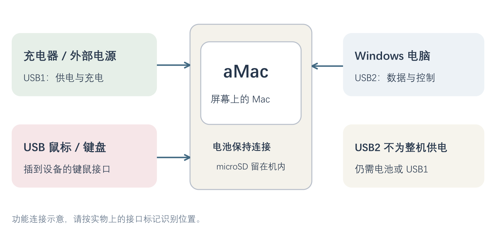
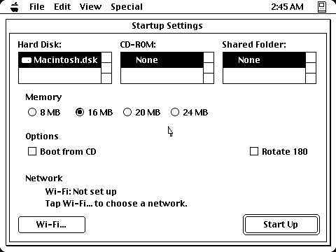
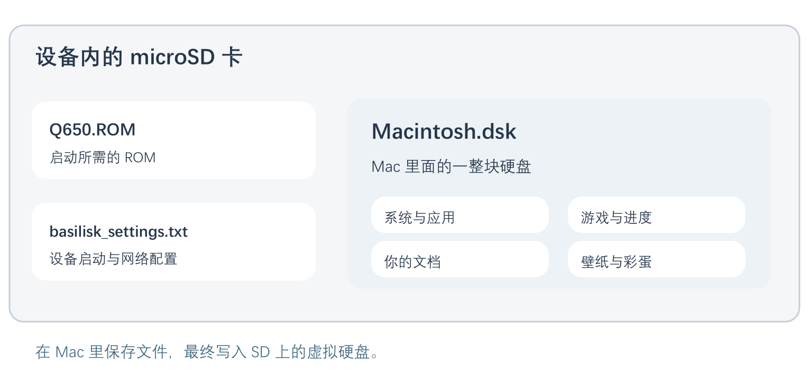
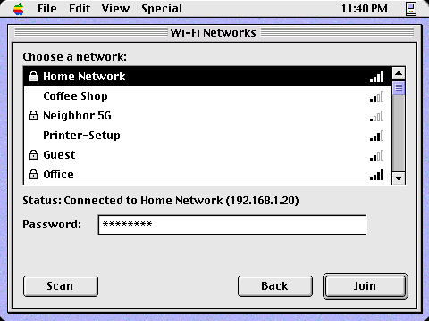
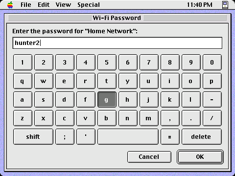
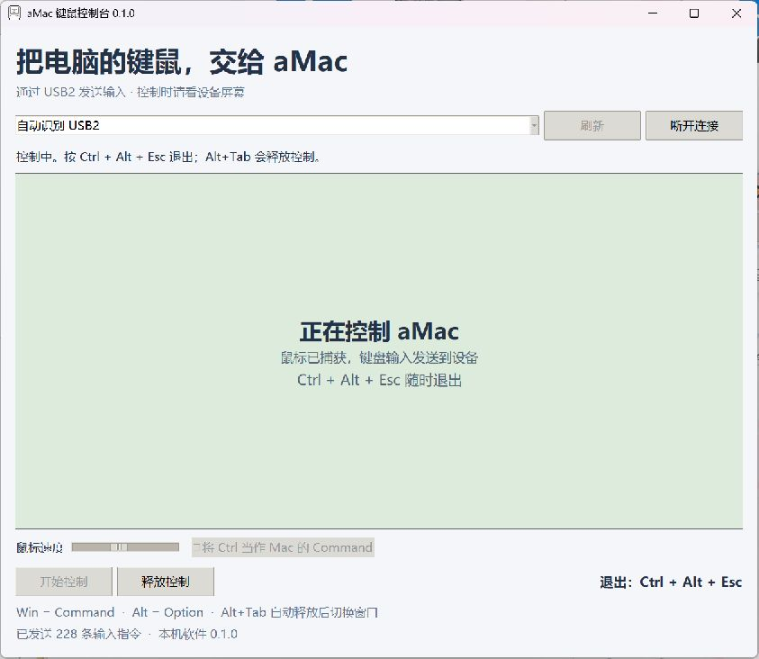
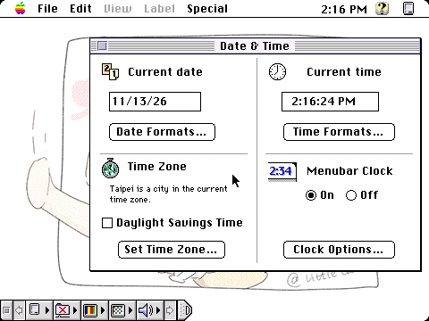
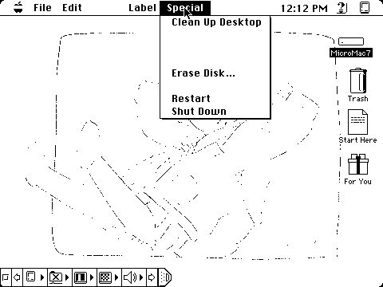
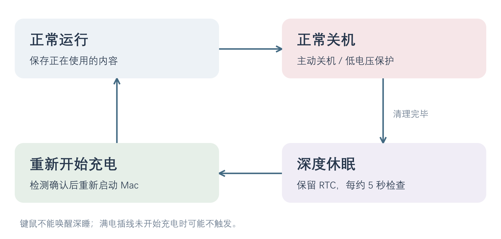
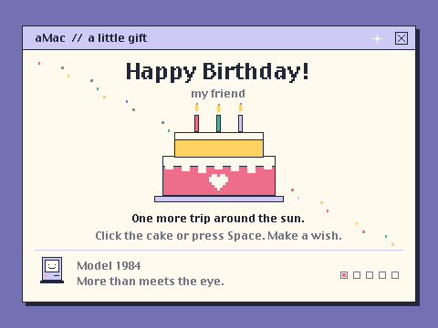

# aMac 使用指南

怎么开机、怎么用、怎么连电脑，以及出了问题怎么在不拆机的情况下处理。

对应版本：设备固件 0.6.3，Windows 键鼠控制台 0.1.0。
硬件：本项目的 ESP32-P4/C5 小电脑，配 HD20034 480×360 屏幕。
写于 2026 年 11 月 13 日。

下面以已经装好系统的生日版为例。界面上的英文保留原样，旁边附中文。
你看到的时间、网络名、硬盘名和内存设置可能和图里不一样，这很正常；Wi-Fi 那几张图用的是演示数据。

[下载图文 PDF](output/pdf/aMac_User_Guide.pdf) · [项目首页](README.md)

## 01 / 第一次开机

1. **接电源。** 电池保持连接，充电线插到设备的 **USB1**。第一次用的时候最好一直插着电。
2. **接鼠标。** USB 鼠标或接收器插到设备的键鼠 USB 口。屏幕不支持触摸，点屏幕没有反应。
3. **等它启动。** 配置好的设备一般会直接进入 Mac，中间可能先出现启动画面。耐心等一会儿，不用反复按 RESET。
4. **如果停在 Startup Settings，** 看一眼 Hard Disk 里是否选中了系统盘，然后点右下角 **Start Up**。看不懂的选项先别动。
5. **看看桌面。** 双击 **Start Here** 是机内说明，双击 **For You** 是这份礼物的入口。
6. **保存。** 在应用里点 **File → Save**，存到 Mac 硬盘，文件名用英文。
7. **关机。** 先保存、退出应用，再在桌面选 **Special → Shut Down**。
8. **再开机。** 关机后设备会进入深睡，重新插上 USB1 充电就能开机。如果关机时本来就插着电，先拔掉 USB1，等 6 秒以上再插回去。电池满电时可能不会触发，见第 10 节。

> 先记住三点：USB1 管供电和充电，USB2 管和电脑传数据；关机用 Shut Down；深睡后动鼠标、按键盘都叫不醒它。

## 02 / 接口和按键

图 1：连接关系示意，只表示功能，不代表接口在板子上的实际位置。请以设备上印的 USB1、USB2 为准。

| 标记 | 作用 | 平时怎么用 |
| --- | --- | --- |
| USB1 | 供电、充电，也带调试串口 | 接充电器；充电唤醒也靠这个口 |
| USB2 | P4 和电脑之间的数据、控制与维护 | 用数据线接 Windows 控制台、维护工具或更新工具 |
| USB 键鼠口 | 接鼠标、键盘或接收器 | 插在设备上，别和连电脑的 USB2 搞混 |
| microSD | 启动文件、Mac 系统盘和配置都在里面 | 一直插着，平时不用拔 |
| RESET / SW2 | 重启主控 | 关机后插着电却叫不醒时用；运行中别拿它当关机键 |
| BOOT / SW3 | 进入烧录模式 | 平时用不到，它也不是开机菜单键 |
| SW1，P4 / C5 | 选择调试对象 | 保持交付时的位置；它不管电源，也不管 Wi-Fi |

只插 USB2 没法给整机供电：这块板上 USB2 的电源脚没有接进供电电路。所以连电脑的时候，也得有电池或 USB1 供电。

连电脑要用能传数据的线。有些线只能充电，插上后电脑里不会多出串口，这时换一根确定能传文件的线就行。

鼠标二选一：要么用插在设备上的 USB 鼠标，要么用第 8 节的电脑键鼠控制台。做维护时先断开控制台，把 USB2 让给维护工具。

## 03 / 开机画面

图 2：Startup Settings 实机截图。图中的时间和 16 MB 内存只是拍照时的设置，不用照着改。

启动的顺序是：设备初始化、读 SD 卡、加载 Mac 系统、出现桌面。控制接口显示“正在运行”时，桌面可能还没加载完，以屏幕上的画面为准。

| 英文选项 | 意思 | 怎么设 |
| --- | --- | --- |
| Hard Disk | Mac 的虚拟硬盘 | 选已有的系统盘，一般叫 Macintosh.dsk |
| CD-ROM | 光盘映像 | 平时选 None，装软件时才用 |
| Shared Folder | 共享文件夹 | 保持原样；它不会自动同步电脑上的文件夹 |
| Memory | 分给 Mac 的内存 | 保持原样；跟存储空间大小无关 |
| Boot from CD | 从光盘启动 | 不勾 |
| Rotate 180 | 画面旋转 180 度 | 画面倒过来时才改 |
| Wi-Fi… | 无线网络设置 | 见第 7 节 |
| Start Up | 保存设置并启动 Mac | 确认无误后点它 |

这一页用设备上的鼠标操作，Wi-Fi 密码也是用鼠标点屏幕键盘输入。电脑键鼠控制台要等 Mac 启动以后才能用。

如果一直停在这一页，先看有没有报错，再确认 Hard Disk 选中了系统盘。提示“保存失败”时先别乱动，检查供电和 SD 卡，千万别靠格式化卡来解决。

## 04 / Mac 桌面

图 3：实机桌面。顶部是菜单栏，右侧依次是系统硬盘、Trash、Start Here 和 For You。

顶部的菜单跟着当前应用走，点了别的窗口，菜单可能就变了。想找桌面的 Special 菜单，先点一下桌面空白处。

| 桌面上的东西 | 是什么 | 怎么用 |
| --- | --- | --- |
| 左上角苹果菜单 | 小工具、控制面板和彩蛋入口 | 点开后选择 |
| File / Edit | 文件、编辑菜单 | 打开、保存、退出、复制、粘贴都在这里 |
| 右上角时间 | Mac 的时钟 | 联网后自动对成台北时间 |
| MicroMac7 等硬盘图标 | Mac 里的硬盘 | 双击打开；名字可能被改过 |
| Trash | 废纸篓 | 删掉的文件先放这里；拿不准就别清空 |
| Start Here | 机内说明 | 建议第一次先读它 |
| For You | 生日礼物入口 | 双击打开，跟着画面上的提示走 |
| 底部小条 | Control Strip 控制条 | 一些系统功能的快捷入口，刚开始可以不管 |

Mac 桌面上的硬盘和 Windows 电脑的磁盘是两回事。在这里存的文档，最后写进 SD 卡上的虚拟硬盘文件，不会出现在电脑桌面上。

窗口左上角的小方框是关闭窗口。窗口关了，应用可能还开着，要彻底退出请用 File → Quit。

## 05 / 鼠标和键盘

| 想做的事 | 怎么做 |
| --- | --- |
| 选中一个图标 | 左键单击 |
| 打开文件、文件夹或应用 | 指针放在图标上，快速双击左键 |
| 拖动 | 按住左键移动，到位置后松开 |
| 移动窗口 | 拖住窗口顶部的标题栏 |
| 用菜单 | 左键点菜单名，再点里面的项目 |
| 取消当前操作 | 先试 Esc；有对话框就点 Cancel |
| 滚动 | 用窗口上的滚动条；滚轮好不好用要看应用 |

直接插在设备上的 Windows 键盘，按键和 Windows 上的习惯不一样：**Windows 键是 Mac 的 Command，Alt 是 Option**，Ctrl 还是 Control。

| 在 Mac 里想做的事 | 直连键盘上按 |
| --- | --- |
| 保存 | Windows 键 + S，或点 File → Save |
| 复制 | Windows 键 + C |
| 粘贴 | Windows 键 + V |
| 全选 | Windows 键 + A |
| 退出当前应用 | Windows 键 + Q，或点 File → Quit |

快捷键能不能用要看应用。刚上手时多用菜单，免得顺手按了 Ctrl+S 却没存上。

右键会被转换成 Control + 左键。System 7 时代的软件大多没有右键菜单，点了没反应不是鼠标坏了。

输入和文件名尽量用英文。这台经典 Mac 不一定装了中文输入法，电脑上开着中文输入法也没用，键鼠控制台传过去的只是物理按键。

## 06 / 保存文件：两层硬盘

图 4：外层是 SD 卡上的文件，里层是 Mac 系统盘里的应用、文档和设置。

### 在 Mac 里存一份文档

1. 打开一个能写字的应用，比如读 Start Here 时用的 SimpleText。
2. 想写自己的东西，就用 **File → New** 新建，别直接改 Start Here 的原文。
3. 写完选 **File → Save**。
4. 选好 Mac 硬盘里的位置，起个英文名，比如 `MyNote`。
5. 点 Save。关文档时如果又问要不要保存，选保存。

游戏和应用的进度要用它们自己的 Save。关机前确认已经存好：深睡醒来后系统会重新启动，之前开着的应用不会原样回来。

### 最重要的三个文件

| SD 卡文件 | 作用 | 能不能删或换 |
| --- | --- | --- |
| Q650.ROM | 模拟器启动要用的 Mac ROM | 不能删，少了它就开不了机 |
| Macintosh.dsk | Mac 虚拟硬盘，系统、应用、文档、壁纸和彩蛋入口都在里面 | 换掉它就等于换掉里面的一切，换之前先备份 |
| basilisk_settings.txt | 启动盘、内存、旋转、Wi-Fi 等设置 | 在设置界面里改，别直接编辑 |

更新固件和换系统盘是两回事。平常更新固件不会动 Mac 里的文档；换一份 Macintosh.dsk，盘里的文档和设置就全换了。

把电脑上的文件复制到 SD 卡根目录，它并不会进到 Mac 硬盘里。要往 Mac 里装软件或换壁纸，得按对应的安装流程来，或者请维护者帮忙。

## 07 / 连接 Wi-Fi

连上一次之后，设备会记住这个网络，以后开机自动连。目前实测能用的是 **2.4 GHz、WPA2** 的网络，第一次设置最好用这种。

### 先回到启动设置

如果设备正停在 Startup Settings，直接点 Wi-Fi… 就行。如果已经进了 Mac 桌面，要借电脑上的维护工具回去：

1. USB1 接着电，用数据线把 USB2 接到电脑。
2. 如果电脑键鼠控制台开着，先退出捕获，再点 **断开连接**。
3. 打开 `scripts/maintain_amac.cmd`，输入 **4**。第一次输入会为下次关机做好维护准备，并显示提示。
4. **10 分钟内**回到 Mac，保存文件，用 **Special → Shut Down** 关机。
5. 回到维护工具，再输一次 **4**，等设备进入启动设置。这次关机会保留维护连接。

顺序不能反：普通关机后只有大约 10 秒的窗口，过了就进入深睡。所以要先在工具里准备好，再去关机。

### 选网络、输密码

图 5：Wi-Fi 界面演示。Home Network 等名称和地址都是示例。图里有个带 5G 字样的网络，但本机并没有验证过 5 GHz。

1. 在 Startup Settings 点左下角 **Wi-Fi…**，等它扫描。
2. 在列表里选你的网络。列表很长的话，点右边的滚动箭头。
3. 点 **Password** 输入框，会弹出屏幕键盘。
4. 用鼠标点出密码，注意大小写。Shift 切换大小写和符号，delete 删掉输错的字。
5. 输完点 **OK** 回到列表，再点 **Join**。
6. 等状态变成 **Connected** 并显示地址。连上后，网络和密码会自动保存，以后自动连接。
7. 点 **Back** 回到启动设置，再点 **Start Up** 启动 Mac。

图 6：屏幕键盘演示，图中的密码只是示例。输入框可能直接显示明文，输完记得点 OK。

扫描最多要等 60 秒左右，连接最多 20 秒左右。没连上就点 Scan 重新扫，别连续猛点 Join。隐藏了名称的网络不会出现在列表里。

设备能上网，不代表 Mac 里的老浏览器能打开现在的网页。目前确认可用的是设备联网、自动校时和维护通信，网页能不能打开要看 Mac 里的浏览器。

## 08 / 用电脑的键鼠操作

图 7：Windows 键鼠控制台，绿色区域表示正在捕获输入。控制和退出都已在实机上试过。

不想另外再接一套键鼠，可以用 **aMac-Control.exe**。它是独立的 Windows 程序，自带运行环境，不用装 Python。

### 第一次连接

1. 设备接着电，用数据线把 USB2 接到 Windows 电脑。
2. 关掉维护工具、更新工具、串口监视器这些占用串口的程序。
3. 双击 **aMac-Control.exe**。在本机上也可以用 `scripts/run_amac_control.cmd`。
4. 保持 **自动识别 USB2**，点 **连接设备**。要手动选的话，以电脑当前识别到的端口为准，本机一般是 COM12。
5. 等设备屏幕出现 Mac 桌面，再点 **开始控制**。
6. 电脑的指针被“抓”进去以后，看着设备的屏幕操作。鼠标、按键和点击都会发给 Mac。
7. 用完按 **Ctrl + Alt + Esc** 把键鼠还给电脑。接下来要用维护工具的话，再点“断开连接”。

### 退出和调整

| 想做的事 | 怎么做 |
| --- | --- |
| 马上退出捕获 | Ctrl + Alt + Esc |
| 切到别的 Windows 窗口 | Alt + Tab，会先释放控制 |
| 调鼠标速度 | 先退出捕获，再拖“鼠标速度”滑块 |
| 让 Ctrl+S 像在电脑上一样保存 | 退出捕获后勾选“将 Ctrl 当作 Mac 的 Command” |
| 改去更新固件或维护文件 | 退出捕获，再点“断开连接” |

默认是 Win = Command，Alt = Option，Ctrl = Control。勾选 Ctrl 当 Command 之后，Ctrl+C、Ctrl+V、Ctrl+S 就能像在电脑上一样用。退出捕获始终是 Ctrl+Alt+Esc。

只有点了“开始控制”、并且控制台窗口在最前面时，输入才会转发过去。窗口失去焦点、被移动或缩放、连接断开时，控制会自动释放。按键内容不会存到文件里。

滚轮目前会转成上下方向键，能不能滚动看应用。电脑的剪贴板、文件和中文输入法都不会同步过去。

控制台只管 Mac 启动以后的操作。Startup Settings 那一页还是要用设备上的鼠标或维护工具。控制台窗口里只显示状态，操作时请看设备的屏幕。

## 09 / 时间自动校准

图 8：Apple → Control Panels → Date & Time。示例日期是 11/13/26，时间用 AM/PM 显示。

固件 0.6.3 连上保存过的 Wi-Fi 后，会自动从网络获取时间，按台北时间（UTC+8）显示。之后每 3 小时校一次，断网重连时也会重新校。

这些都在后台进行，Mac 停在哪个页面都可以。刚开机时可能先显示上次保存的旧时间，拿到网络时间后才跳到现在。

### 怎么确认校好了

最直接的是看桌面右上角的时间。想再确认，就在电脑维护工具里输入 **9 时间同步状态**，能看到当前日期时间，以及“等待联网”“正在获取网络时间”或“已校时”。查看时不用关 Mac，但要先断开键鼠控制台的串口连接。

12 小时制里 AM 是上午，PM 是下午，比如 2:26 PM 就是 14:26。日期 11/13/26 是 2026 年 11 月 13 日。

没网的时候，设备靠 RTC 时钟接着走时，正常深睡时 RTC 也会保留。如果完全断电，或者按 RESET 冷启动，可能会先回到最近保存的时间点，联网后再校准。

也可以在 Date & Time 控制面板里手动改，不过联网后又会被校回台北时间。如果一直校不上，先查 Wi-Fi 和网络，再看第 16 节。

## 10 / 关机、深睡和再次开机

图 9：先回到桌面，再选 Special → Shut Down。菜单里的 Erase Disk… 是擦除磁盘，不是关机。

### 每次离开前

1. 在应用或游戏里存好内容。
2. 弹出保存提示的话，先处理掉；还想接着用，就点 Cancel 取消关机。
3. 退出应用，点一下桌面空白处，打开 **Special** 菜单。
4. 选 **Shut Down**，等系统退出、屏幕熄灭。

点了 Shut Down 并不会马上断电：系统清理完后还会留大约 10 秒的维护窗口，之后才进入深睡。

图 10：深睡时 RTC 继续走；再次开机需要一个新的充电信号，设备大约每 5 秒检查一次。

### 电压规则

| 情况 | 设备会怎么做 |
| --- | --- |
| 没在充电，电池电压低于 4.10 V（不含）持续 5 秒 | 让 Mac 正常关机，清理完直接进入深睡 |
| 正在充电 | 不触发这条自动关机 |
| 手动选 Shut Down | 正常关机，然后深睡 |
| 深睡时检测到开始充电 | 重新启动 Mac |

4.10 V 是这一版定的保守值，到这个电压时电池其实还有电。旧版本里 3.9 V 熄屏、3.7 V 深睡的规则已经取消，以这张表为准。

深睡和电脑的“休眠”不一样，它不保存运行中的内存，只保留 RTC 和少量设备状态，醒来后 Mac 会重新启动。游戏和文档要靠你之前的保存。

### 深睡后怎么开机

关机时 USB1 没插着：插上 USB1 让电池开始充电，一般过一次约 5 秒的检查，就会正常启动。

关机时 USB1 本来就插着：先拔掉，等 6 秒以上再插回去，让设备先检测到“停止充电”。拔插太快可能检测不到。

满电时插线不一定能开机。设备只认“开始充电”这个信号，没有单独的插线检测。电池很满、插回去也没开始充电的话，确认 Mac 已经关机后，按 RESET/SW2 重启就行。

深睡时动鼠标、按键都没用。如果只是屏幕保护，动一下鼠标或按 Shift 就能回来，别把屏保和深睡搞混了。

## 11 / 电池和充电状态

双击电脑上的 `scripts/maintain_amac.cmd`，输入 **8 电池与充电状态**。Mac 运行时和在维护设置里都能看，不用关机。

| 显示 | 意思 |
| --- | --- |
| 电池电压，例如 4.200 V | 设备采样的读数，可以参考，但没用万用表校准过 |
| 正在充电 | 充电芯片报告正在给电池充电 |
| 未在充电 | 可能没插 USB1，也可能已经充完，单看这一句判断不了是不是满电 |
| 等待充电状态稳定 | 刚切换了供电，过几秒再看 |
| 采样无效或已过期 | 这次读数不可信，重新看一次，并检查供电 |

Mac 里的电池百分比功能默认是关的，所以看不到百分比或者显示 0，都不说明电池没电。低电压保护用的是实际采样，不受影响。

电压没法直接换算成剩余电量；插上充电线后电压上升，也不代表已经充满。整机深睡电流和完整续航还没测过，所以没法从 3000 mAh 算出能放几天。

如果经常一拔 USB1 就自动关机，先接回充电，再请维护者看看电压和阈值。别靠反复按复位来绕过关机保护。

## 12 / 从 For You 开始

图 11：For You 的蛋糕页面。这只是开头，留意画面里的小提示。

桌面上有两个文件适合最先打开：**Start Here** 是说明，**For You** 是生日礼物。

1. 双击 For You，读读屏幕上的英文。
2. 点一下蛋糕，或者按空格许个愿。
3. 画面会告诉你下一站在哪。可以去苹果菜单里找找控制面板、Pocket Terminal 和 About This Gift。
4. 终端不会用的话，先输入 `help` 回车。
5. 想回到 Mac，点页面上的关闭按钮，或者在对应页面按 Esc。

系统里藏了大约五个小惊喜，有的一眼就能看到，有的藏得很深。这里不剧透，跟着线索慢慢找吧。

在礼物页面里按键，不会传给后台的 Mac 应用。有些子页面用 Back、Enter 或 Esc 返回上一级，点右上角的关闭按钮可以直接回到桌面。

探索进度只在这次开机内有效，重启后可以从头再玩。要是桌面上找不到 For You，多半是换了一份没装生日入口的系统盘；光更新固件不会把这些图标变出来。

## 13 / 壁纸和个性化

生日版已经装好了壁纸工具 **Décor**，开机时会加载保存的壁纸。如果一开始看到的是灰色背景，等桌面加载完再看。

### 换一张 Mac 硬盘里已有的图片

1. 双击 Mac 硬盘，进入 **Décor ƒ** 文件夹，打开 **Décor**。
2. 点 **Change…**，选一张 Mac 硬盘里的图片。
3. 开关拨到 **On**，桌面效果满意了就关掉 Décor 窗口。
4. 别删已经装好的 Décor Daemon 扩展，之后开机要靠它加载设置。

现在的壁纸是 `MicroMac7:Wallpaper.gif`。冒号是 Mac 的路径写法，不是 Windows 路径。屏幕是 480×360，原图也是按这个尺寸做的。

如果图片还在 Windows 电脑上，要请维护者转换好放进 Mac 系统盘，或者按项目里的壁纸维护说明操作。只把 PNG 复制到 SD 卡根目录，桌面不会变。

生日祝福里的名字和信的正文，目前要由维护者改固件配置、重新编译，没法在“Birthday Settings”里直接输入保存。

设备没有触摸屏和音频接口，这一版也没有亮度渐变，调亮度数值时屏幕不一定会变暗。遇到这些不是你操作错了。

## 14 / 电脑维护工具

平时用不到维护工具。连网络、备份系统盘、换卡里的文件或者更新固件时才需要它。

在本机的项目目录 `E:\AMac\firmware` 里双击 `scripts\maintain_amac.cmd`，输入菜单编号后回车。换一台电脑，目录可能不一样。

| 编号 | 用途 | 要不要先关 Mac |
| --- | --- | --- |
| 1 | 查看卡内文件 | 要先进入维护设置 |
| 2 | 复制文件到设备 | 要先进入维护设置 |
| 3 | 备份文件到电脑 | 要先进入维护设置 |
| 4 | 准备维护 / 进入维护设置 | Mac 开着时先选一次做准备，正常关机后再选一次 |
| 5 | 启动 Mac | 维护完以后用 |
| 6 | 查看实体 USB 鼠标状态 | 不用；电脑控制台的输入不算在这里 |
| 7 | 更新设备固件 | 工具会检查运行状态，按提示先正常关机 |
| 8 | 查看电池与充电状态 | 不用 |
| 9 | 查看时间同步状态 | 不用 |
| 0 | 退出维护工具 | 不会顺带关掉 Mac |

一个串口同一时间只能给一个工具用。键鼠控制台退出捕获后串口还占着，用维护工具前要在控制台里点“断开连接”。

### 换一台电脑时

维护用的 `.cmd` 脚本需要事先准备好的 Python 和项目环境。从 GitHub 下载的源码 ZIP 里没有本地 `.pio-core` 环境，也没有发布好的固件，拿到手是没法直接双击用的。

最省事的是向维护者要一份配好的维护目录。开发环境怎么搭，见项目里的更新说明。独立的 **aMac-Control.exe** 自带运行环境，用不着这一套。

## 15 / 备份、换文件和更新固件

### 先学会备份系统盘

1. USB2 用数据线接电脑，USB1 接着电，先断开键鼠控制台。
2. 打开维护工具，选 **4**，为下次关机做准备。
3. 10 分钟内回到 Mac，保存内容并正常 Shut Down，然后在工具里再选一次 **4**。
4. 选 **1** 查看 SD 卡里的文件，确认系统盘的文件名。
5. 选 **3**，输入卡里的文件名，比如 `Macintosh.dsk`。
6. 输入电脑上的完整保存路径，比如 `E:\AMacBackup\Macintosh-2026-11-13.dsk`。目标文件夹要提前建好，并确认空间够用。
7. 工具提示完成后，把这份备份收好，再选 **5** 启动 Mac。

完整系统盘大约 1 GB，传起来会很慢。线、电源和程序都别动，进度一时不走不代表失败了。平时更新固件不需要重传整个系统盘。

### 往 SD 卡复制一个文件

在维护设置里选 **2**，输入电脑上源文件的完整路径，再输入卡里的文件名。这个功能只能往 SD 卡根目录放普通文件，文件名用英文或数字、不超过 80 个字符，不能整个文件夹复制。

工具会先写临时文件并校验，成功了才替换目标文件，旧文件改名为 `.previous` 留着。不过下次再成功替换同一个文件时，这份旧文件会被覆盖，重要的东西还是另存一份到电脑上。

替换 Macintosh.dsk 就是替换盘里的全部内容。Mac 还在运行时别动这个文件，也别同时在电脑模拟器里打开同一份磁盘往里写。

### 日常更新固件

1. 向维护者要适合这台机器的发布镜像和配套的 JSON 校验文件。这台是 P4 v3.2，用 **Rev3** 版本；ES、Tab5、Waveshare 的镜像都不适用。
2. USB1 接着电，USB2 接电脑，关掉其他占用串口的程序。
3. 如果 Mac 正在运行，先打开 `scripts/update_amac.cmd`。这一次它只会准备维护并提示你关机，不会写入。
4. 10 分钟内保存并正常 Shut Down，然后重新打开更新工具。
5. 等它依次完成检查、备份、写入和独立校验，成功后设备会自动重启。
6. 进入桌面后，看看自己的文档、壁纸和彩蛋入口还在不在，再确认网络和时间。

日常更新不会动 SD 卡、Mac 系统盘和设备配置。无线芯片 C5 的固件是单独的，不用每次跟着刷。如果工具提示引导版本未知、镜像不匹配或备份校验失败，先停下来，把提示内容交给维护者。

按 BOOT、拨烧录开关、全片擦除、手动指定地址这些都不属于日常更新。网上其他开发板的烧录教程，别照搬到这台机器上。

## 16 / 出问题时怎么查

### 黑屏，插上线也不开机

1. 确认插的是 **USB1**，不是只插了 USB2；电池也要接好。
2. 如果刚关机、线一直插着，拔掉 USB1 等 6 秒以上再插回去，然后给它一点检查和启动的时间。
3. 电池很满时可能没有新的充电信号。确认 Mac 已经关机后，按 RESET/SW2 启动。
4. 如果是屏保，动动鼠标或按 Shift。还是没反应，再分辨是深睡还是供电问题。

### 鼠标不动、时灵时不灵或乱跳

先看看机器是不是还在启动。把设备上的 USB 鼠标拔下，等 3 秒左右再插回去试试，别把电源一起拔了。

用维护菜单 **6** 看鼠标是“已连接”还是“未检测到”，以及输入报告数。未检测到，先查接收器、线和接口；已连接但移动时报告数不涨，换一只鼠标对比。厂商自带的状态包不一定算作有效移动。

用电脑控制台时，确认点了“开始控制”、窗口在最前面；按 Ctrl+Alt+Esc 释放后调低鼠标速度再试。控制台和实体鼠标走的是两条路，菜单 6 看不出控制台是否在工作。

### 电脑控制台连不上

检查 USB2 是不是数据线、设备有没有供电、维护工具或串口监视器是不是还占着端口（退出捕获并没有断开串口）。必要时刷新端口列表手动选，COM12、COM7 只是本机用过的编号。设备深睡时串口可能会消失，先充电唤醒，别为此反复按 BOOT 或拨 P4/C5 开关。

### Wi-Fi 扫不到网络

把设备拿到 2.4 GHz、WPA2、广播名称的网络附近，点 Scan 等一会儿。“模块启动失败”“扫描失败”和“列表为空”是三种不同的情况，先看清是哪一种。初始化或扫描一直失败的话，记下完整提示请维护者检查 C5，不要自己往 C5 上刷其他型号的无线固件。

### Wi-Fi 连上了，时间却不对

确认这个网络能上外网，等一会儿，再用菜单 **9** 看是不是“已校时”。显示 Connected 只说明连上了网络，不一定已经拿到时间。离线冷启动时显示旧的时间点是正常的，联网后会校准。

### 保存失败、找不到系统盘、总回到启动设置

记下报错，确认供电稳定、Hard Disk 选的是正确的系统盘。别随手格式化 SD 卡，也别删 ROM、系统盘或恢复标记碰运气。能备份就先备份，再交给维护者检查卡和配置。

### 没声音、点屏幕没反应、亮度变化不明显

这台机器没有启用触摸和音频，背光只有开和关，软件里的亮度百分比并不能连续调光。本来就是这样，不用为此重装 Mac。

### 程序卡住了

先等一等，试着退出当前应用，看看是不是有对话框挡着。鼠标还能动的话，尽量保存后正常关机。RESET 会直接中断运行，没保存的内容会丢，留到最后再用。重启后如果进了维护设置，别直接清空系统盘。

## 17 / 速查表

| 我想… | 去哪里 |
| --- | --- |
| 看机内说明 | 桌面 Start Here |
| 打开生日礼物 | 桌面 For You |
| 关机 | 桌面 Special → Shut Down |
| 用电脑键鼠操作 | aMac-Control.exe → 连接设备 → 开始控制 |
| 把键鼠还给电脑 | Ctrl + Alt + Esc |
| 设置 Wi-Fi | 进入维护设置 → Wi-Fi… |
| 看电压、是否在充电 | 维护菜单 8 |
| 看时间校好没有 | 维护菜单 9 |
| 备份系统盘 | 正常关机进入维护 → 菜单 3 |
| 更新固件 | scripts/update_amac.cmd |

| 英文 | 中文 |
| --- | --- |
| File / Edit | 文件 / 编辑 |
| Save / Save As… | 保存 / 另存为 |
| Quit / Close | 退出应用 / 关闭窗口 |
| Cancel / OK | 取消 / 确定 |
| Special / Shut Down / Restart | 特殊菜单 / 关机 / 重新启动 |
| Scan / Join / Back | 扫描 / 加入网络 / 返回 |
| Connected / Connecting | 已连接 / 正在连接 |
| None / Start Up | 不选 / 启动 |
| Command / Option | Mac 的修饰键，对应 Windows 键 / Alt |

这份指南给使用的人，完整的彩蛋答案留给送礼的人。遇到看不懂的提示，先拍下来或者抄下来，再去找维护者。大多数问题都用不着拆机、拔卡或重装系统。

## 18 / 版本说明

本指南根据项目代码、0.6.3 实机测试和 Windows 控制台 0.1.0 写成。实机上验证过的有：System 7 启动、SD 文件维护、壁纸、生日入口、Wi-Fi 连接、网络校时与重连、正常关机深睡、充电唤醒，以及电脑键鼠控制和退出。

还没实测的有：电池真的降到 4.10 V 以下时的自动关机、整机深睡电流、RTC 长期误差。3 小时的校时间隔来自当前 SDK 的固定配置，这次没有等满一个周期去验证。5 GHz、蓝牙、触摸、音频和现代网页兼容性都不在本指南的验收范围内。

关于插图：桌面、启动设置、关机菜单、日期面板和控制台来自实机或实际运行的软件；Wi-Fi 和密码键盘是同一套界面的演示渲染，网络名和密码是示例；连接、文件层次和电源流程图是示意图，不代表实物尺寸和位置。壁纸插画用的是用户提供的礼物素材，保留原署名，版权归原作者。

延伸阅读：[移植与硬件说明](AMAC_PORT.md)、[不拆机更新](AMAC_UPDATES.md)、[关机与充电唤醒](AMAC_POWER_OFF.md)、[自动校时](AMAC_TIME.md)、[电脑键鼠控制台](AMAC_DESKTOP_CONTROL.md)、[验证记录](AMAC_VALIDATION.md)。

送礼人想看完整的彩蛋答案，可以单独读项目里的生日彩蛋清单。那份有剧透，别和这份开机说明一起拿给朋友看。
